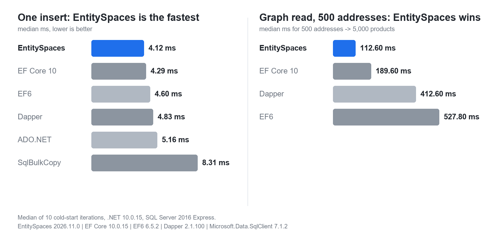

# EntitySpaces vs. .NET ORMs — Benchmarks

BenchmarkDotNet comparison of **EntitySpaces 2026.11** against **Dapper 2.1**, **Entity Framework Core 10**, **Entity Framework 6.5** and **raw ADO.NET** on SQL Server, all on **.NET 10 LTS**. Same database, same schema, same workload: cold-start latency, managed allocations and how each stack scales from 1 to 5,000 rows.

*This project builds on the benchmark baseline created by [MarcosDevTi](https://github.com/MarcosDevTi/Benchmark_Dapper2.0.78_vs_EntityFramework6.4.4_vs_EntityFrameworkCore6.0). It has been upgraded to .NET 10, extended with graph read/write scenarios, and re-focused to compare **EntitySpaces** against the current de facto .NET ORMs.*

## Who this is for

- **Developers** choosing between EntitySpaces, Dapper, EF Core and EF6: per-scenario medians, allocations, and the SQL shape behind each number.
- **Project leads** planning a move to .NET 10 LTS from a .NET Framework app — WinForms, WebForms, or a plain ADO.NET data layer: EF6 still runs there, and the same workload is measured on both sides, so the data layer can be sized before committing.
- **CTOs and architects** assessing risk: reproducible runs, archived results behind every published number, and the known limits stated up front.

## Summary

- **Reads are competitive.** From 1 to 5,000 rows EntitySpaces stays **1.1–1.4× behind Dapper** (0.568 vs 0.526 ms at one row; 32.3 vs 25.5 ms at 5,000) and **1.3–1.7× ahead of EF Core 10 and EF6** from 500 rows up, with EF6 allocating **3× the memory** at 5,000 rows.
- **Single-row writes are its best case.** One product insert takes **4.12 ms — the fastest of the five stacks**, ahead of EF Core (4.29 ms) and Dapper (4.83 ms).
- **Bulk inserts are its worst case.** The implementation calls `Save()` once per entity, so 200 inserts cost **303 ms against 92.5 ms for EF Core** and 94.1 ms for `SqlBulkCopy`: a 3.3× gap that comes from round trips, not from mapping.
- **Graph writes hold up.** A customer with its address, 5 products and 5 product pages costs 276 ms at 20 customers, **1.18× behind Dapper** and **1.19× ahead of EF6**.
- **Graph reads win at scale.** 500 addresses with their customers and products take **113 ms in EntitySpaces**, against 190 ms in EF Core, 413 ms in Dapper and 528 ms in EF6.



*Left: the single-insert scenario, where EntitySpaces is the fastest of the five stacks. Right: the graph read of 500 addresses (5,000 products), where it wins at scale. Median of 10 cold-start iterations on .NET 10.0.15.*

> Every number below comes from the 2026-11-20 run on .NET 10. The raw BenchmarkDotNet output is committed under [`docs/results/`](docs/results/) and the previous .NET 8 / EntitySpaces 2026.8 run is kept there as the baseline.

## At a glance

Median time per operation; lower is better.

| Scenario | rows/op | EntitySpaces | Fastest | Fastest time | ES vs fastest |
|---|---:|---:|---|---:|---:|
| Read, 1 product | 1 | 0.568 ms | Dapper | 0.526 ms | 1.08× |
| Read, 5 products | 5 | 0.575 ms | Dapper | 0.520 ms | 1.11× |
| Read, 50 products | 50 | 1.14 ms | Dapper | 0.806 ms | 1.42× |
| Read, 500 products | 500 | 4.67 ms | Dapper | 3.29 ms | 1.42× |
| Read, 5,000 products | 5,000 | 32.3 ms | Dapper | 25.5 ms | 1.27× |
| Insert, 1 product | 1 | **4.12 ms** | EntitySpaces | 4.12 ms | 1.00× |
| Insert, 5 products | 5 | 11.3 ms | EF Core | 5.75 ms | 1.96× |
| Insert, 20 products | 20 | 45.6 ms | ADO.NET | 15.6 ms | 2.92× |
| Insert, 200 products | 200 | 303 ms | EF Core | 92.5 ms | 3.28× |
| Graph read, 1 address | 1 | 1.20 ms | Dapper | 0.863 ms | 1.39× |
| Graph read, 5 addresses | 5 | 2.22 ms | Dapper | 1.98 ms | 1.12× |
| Graph read, 50 addresses | 50 | 11.4 ms | Dapper | 8.72 ms | 1.31× |
| Graph read, 500 addresses | 500 | **113 ms** | EntitySpaces | 113 ms | 1.00× |
| Graph write, 1 customer | 1 | 26.2 ms | Dapper | 15.9 ms | 1.65× |
| Graph write, 5 customers | 5 | 101 ms | Dapper | 73.5 ms | 1.37× |
| Graph write, 20 customers | 20 | 276 ms | Dapper | 233 ms | 1.18× |

## What is measured

Every ORM performs the **same logical work** against the **same database**, in the same process, in the same BenchmarkDotNet run. Each benchmark method is one cold-start iteration group: the ORM is configured once and the operation is executed per iteration.

| Family | Benchmark classes | Operation |
|---|---|---|
| Read, single table | `SinglesSelects{1,5,50,500,5000}` | `SELECT TOP(n)` of 6 columns from `efdp_product`, materialized into objects/DTOs |
| Write, single table | `SinglesInserts{1,5,20,200}` | insert n `Product` rows (no FK): ADO.NET multi-row `INSERT`, `SqlBulkCopy`, Dapper `ExecuteAsync`, EF Core/EF6 `AddRange + SaveChanges`, EntitySpaces `Save()` per entity |
| Graph read | `ComplexSelects{1,5,50,500}` | n root addresses → customers → products → product pages, flat join plus in-memory grouping into nested DTOs |
| Graph write | `ComplexInserts{1,5,20}` | n customers, each with 1 address, 5 products and 5 product pages, saved as a single graph |
| Isolation runs | `SinglesSelectsEntitySpaces1`, `SinglesInsertsEntitySpaces1` | EntitySpaces alone in a process, to confirm its row is not affected by sharing a job with the other ORMs |

The isolation runs measured **0.606 ms** (select) and **4.9 ms** (insert) for EntitySpaces, against 0.568 and 4.1 ms in the shared job: sharing the process does not penalize it.

`dotnet run -- --validate` cross-checks the graph-read implementations. It printed the same addresses, customers and products for the four ORMs and exposed two broken implementations that the timings alone would have hidden — see [Validating the scenarios](#validating-the-scenarios).

### Environment

| Item | Value |
|---|---|
| Machine | AMD Ryzen 5 PRO 4650U — 6 physical / 12 logical cores, 2.10 GHz |
| OS | Windows 10 22H2 (10.0.19045.6466) |
| Runtime | .NET 10.0.15, X64 RyuJIT (x86-64-v3) |
| SDK | .NET 10.0.404, pinned through `global.json` |
| BenchmarkDotNet | 0.15.8 — `RunStrategy=ColdStart`, 10 iterations, 3 warmups, `MemoryDiagnoser` |
| Database | SQL Server 2016 SP2 Express (13.0.5026.0), instance `VANHALEN\SQLEXPRESS`, database `CamparationEntityDapper` |
| Run | 2026-11-20, 18:53–19:06 (local time, UTC-3) |

### Versions under test

| Component | Version | Notes |
|---|---|---|
| EntitySpaces | `EntitySpaces.ORM.SqlServer.NET` **2026.11.0** | `Efdp*` entities generated with EntitySpaces Studio 2026.11.0001.0 |
| Dapper | **2.1.100** (+ `Dapper.Contrib` 2.0.78) | |
| EF Core | `Microsoft.EntityFrameworkCore.SqlServer` **10.0.15** | |
| EF6 | `EntityFramework` **6.5.2** | the legacy ORM line, still running on .NET 10 — see the note below |
| SQL client | `Microsoft.Data.SqlClient` **7.1.2** | used by ADO.NET, Dapper, EF Core and EntitySpaces; EF6 uses `System.Data.SqlClient` internally, the only exception |
| Target framework | `net10.0` | |

> **EF6 is not an out-of-date EF Core.** Entity Framework 6 (6.5.2) is the .NET Framework-era ORM, in maintenance and with no 6.x successor; **EF Core 10.0.15** is the current LTS line and its successor. Both are benchmarked in the same run, so EntitySpaces is compared against the legacy stack (EF6) and the current one (EF Core 10) at the same time.


## Results

All numbers are **medians of 10 cold-start iterations**. The appendix has the full BenchmarkDotNet output (mean, error, standard deviation, allocations). `Mean` is inflated by one-off cold-start stalls (JIT, first connection, GC), which is why the analysis uses medians.

### Reads — single table (median ms)

| ORM | 1 | 5 | 50 | 500 | 5,000 |
|---|---:|---:|---:|---:|---:|
| ADO.NET | 0.597 | 0.732 | 1.06 | 4.89 | 26.8 |
| Dapper | 0.526 | 0.520 | 0.806 | 3.29 | 25.5 |
| **EntitySpaces** | 0.568 | 0.575 | 1.14 | 4.67 | 32.3 |
| EF Core 10 | 1.02 | 1.14 | 1.74 | 6.04 | 40.8 |
| EF6 | 1.40 | 1.37 | 1.76 | 7.51 | 56.1 |

Allocated memory per operation:

| ORM | 1 | 5 | 50 | 500 | 5,000 |
|---|---:|---:|---:|---:|---:|
| ADO.NET | 8 KB | 11 KB | 52 KB | 445 KB | 4.30 MB |
| Dapper | 6 KB | 9 KB | 45 KB | 397 KB | 3.84 MB |
| **EntitySpaces** | 29 KB | 35 KB | 103 KB | 839 KB | 8.54 MB |
| EF Core 10 | 14 KB | 17 KB | 88 KB | 774 KB | 7.46 MB |
| EF6 | 57 KB | 76 KB | 313 KB | 2.62 MB | 25.67 MB |

### Writes — single table (median ms)

| ORM | 1 | 5 | 20 | 200 |
|---|---:|---:|---:|---:|
| ADO.NET | 5.16 | 7.79 | 15.6 | 151 |
| ADO.NET SqlBulkCopy | 8.31 | 8.47 | 16.4 | 94.1 |
| Dapper | 4.83 | 9.66 | 20.4 | 128 |
| **EntitySpaces** | 4.12 | 11.3 | 45.6 | 303 |
| EF Core 10 | 4.29 | 5.75 | 16.6 | 92.5 |
| EF6 | 4.60 | 8.57 | 20.7 | 171 |

Allocated memory per operation:

| ORM | 1 | 5 | 20 | 200 |
|---|---:|---:|---:|---:|
| ADO.NET | 755 KB | 801 KB | 910 KB | 2.63 MB |
| ADO.NET SqlBulkCopy | 786 KB | 804 KB | 893 KB | 1.91 MB |
| Dapper | 758 KB | 829 KB | 924 KB | 2.47 MB |
| **EntitySpaces** | 761 KB | 842 KB | 1.04 MB | 3.91 MB |
| EF Core 10 | 778 KB | 887 KB | 1.17 MB | 5.09 MB |
| EF6 | 853 KB | 1.10 MB | 2.06 MB | 13.61 MB |

### Graph reads — address → customers → products → product pages (median ms)

| ORM | 1 | 5 | 50 | 500 |
|---|---:|---:|---:|---:|
| Dapper | 0.863 | 1.98 | 8.72 | 413 |
| **EntitySpaces** | 1.20 | 2.22 | 11.4 | 113 |
| EF Core 10 | 2.47 | 4.26 | 20.2 | 190 |
| EF6 | 10.5 | 14.5 | 39.4 | 528 |

Allocated memory per operation:

| ORM | 1 | 5 | 50 | 500 |
|---|---:|---:|---:|---:|
| Dapper | 27 KB | 94 KB | 838 KB | 8.14 MB |
| **EntitySpaces** | 120 KB | 219 KB | 1.44 MB | 14.87 MB |
| EF Core 10 | 163 KB | 352 KB | 2.47 MB | 23.70 MB |
| EF6 | 1.78 MB | 2.46 MB | 10.07 MB | 85.91 MB |

### Graph writes — customer + address + 5 products + 5 product pages (median ms)

| ORM | 1 | 5 | 20 |
|---|---:|---:|---:|
| Dapper | 15.9 | 73.5 | 233 |
| **EntitySpaces** | 26.2 | 101 | 276 |
| EF Core 10 | 18.8 | 101 | 236 |
| EF6 | 39.0 | 122 | 327 |

Allocated memory per operation:

| ORM | 1 | 5 | 20 |
|---|---:|---:|---:|
| Dapper | 1.36 MB | 6.76 MB | 27.00 MB |
| **EntitySpaces** | 1.48 MB | 7.26 MB | 28.97 MB |
| EF Core 10 | 1.63 MB | 8.08 MB | 32.31 MB |
| EF6 | 2.81 MB | 13.63 MB | 54.18 MB |

## What the numbers mean

### Reads

EntitySpaces' read path sits between Dapper/ADO.NET and the two Entity Framework stacks. At 5,000 rows it needs 32.3 ms against 25.5 ms for Dapper and 26.8 ms for ADO.NET — **27% and 20% behind** — while EF Core 10 needs 40.8 ms and EF6 56.1 ms, so EntitySpaces is **1.26× and 1.74× ahead** of them. Per row that is **6.5 µs**, against 5.1 µs for Dapper, and the gap comes from how much work each layer adds per row: Dapper and ADO.NET hand back plain objects, EntitySpaces builds its own entity collection, and both Entity Framework stacks add materialization and change tracking.

The memory picture is different from the latency picture. Dapper's allocation dropped when the run moved to `Microsoft.Data.SqlClient` 7.1.2 and .NET 10 (8.02 MB → 3.84 MB at 5,000 rows), while EntitySpaces stayed at 8.54 MB, so what used to be parity is now **2.2× Dapper**. The projection and its collection objects dominate; the row data does not.

At small N the fixed cost rules everything: 0.53–0.60 ms for a single row across ADO.NET, Dapper and EntitySpaces. EntitySpaces is **8% behind Dapper** there and allocates 29 KB against 6 KB.

### Writes

This is the one family where the implementations are not alike, and the README says so explicitly: ADO.NET, Dapper, EF Core and EF6 write n rows through a batched path (a single multi-row `INSERT`, a `SqlBulkCopy` operation, one Dapper command, or `AddRange` + `SaveChanges`, which EF Core batches internally), while the EntitySpaces implementation calls `esProduct.Save()` **once per entity** — one round trip and one statement per row.

The shape of the results follows from that. EntitySpaces is **the fastest stack for a single insert** (4.12 ms, ahead of EF Core's 4.29 ms) because it skips the ORM plumbing the others pay for. From 20 rows on, the per-row round trips dominate: 45.6 ms against 15.6 ms for ADO.NET, and 303 ms against 92.5 ms for EF Core at 200 rows — **1.5 ms per row against 0.46 ms**. The gap is round trips, not mapping.

Practical reading: keep EntitySpaces' per-entity `Save()` for one-graph-at-a-time work (see graph writes) and use a batch path for volume. Adding an EntitySpaces bulk variant to this suite is the most valuable next step.

### Graph writes

With cascading save (`customerCollection.Save()`, one transaction for the whole graph) EntitySpaces closes most of the gap: 26.2 ms for one customer, 101 ms for five, **276 ms for twenty** — 1.18× behind Dapper, 1.17× behind EF Core and **1.19× ahead of EF6** (327 ms). It also allocates less than both Entity Framework versions at every size (29.0 MB vs 32.3 MB and 54.2 MB at 20 customers).

For legacy modernization — the case this repository targets — that is the shape that matters: a customer with its address, products and pages written as one graph, in one transaction, with no explicit transaction handling in application code.

### Graph reads

This family changed the most during the 2026-11 validation, because two of the four implementations were returning the wrong graph (see below). With all four loading the same 5,000 rows, **EntitySpaces wins at scale**: 113 ms at 500 addresses against 190 ms for EF Core 10 (1.7×), 413 ms for Dapper (3.7×) and 528 ms for EF6 (4.7×).

The reason is visible in the SQL shape. Dapper and EntitySpaces run the same `IN (SELECT TOP n …)` join, but Dapper materializes 5,000 flat rows through its mapper and then groups them in LINQ; EntitySpaces materializes its own collection and groups dynamic rows. EF6 and EF Core take a different route (500-key `Contains` plus `Include`), which EF Core handles well and EF6 does not: EF6's 528 ms and **85.9 MB** are the cost of materializing 5,000 tracked-then-detached entity graphs.

At small N the order flips: Dapper is fastest up to 50 addresses, and EntitySpaces is 1.4× behind at one address because of its per-call collection setup.

## Validating the scenarios

A timing comparison is only meaningful when every implementation returns the same graph, so the runner has a `--validate` mode that executes the four graph reads outside BenchmarkDotNet and prints addresses, customers and products per ORM. On the first run it caught two defects that no timing could reveal:

| ORM | addresses | customers | products | Verdict |
|---|---:|---:|---:|---|
| Dapper | 500 | 500 | 5,000 | correct |
| EF Core | 500 | 500 | 5,000 | correct |
| EF6 | 500 | **0** | **0** | `Include`/`AsNoTracking` were resolving to the EF Core extensions, which the EF6 provider ignores |
| EntitySpaces | **1** | 500 | 5,000 | grouped by the entity `Id`, absent from the projection, so every row collapsed into one address |

Both are fixed in this repository, and the effect on the numbers was large: EF6's "14 ms at 500 addresses" was really a query that loaded only the addresses; with the full graph it takes 528 ms. EntitySpaces went from a meaningless 125 ms for one collapsed address to 113 ms for 500 real ones.

The lesson is in the code comments: in a file that imports both `System.Data.Entity` and `Microsoft.EntityFrameworkCore`, `Include("...")` and `AsNoTracking()` bind to the EF Core versions, silently, and the EF6 provider simply ignores them.

## What changed since the .NET 8 baseline

The 2026-11-20 baseline run (`.NET 8`, EntitySpaces 2026.8, EF Core 8) is committed under [`docs/results/2026-11-20-net8/`](docs/results/2026-11-20-net8). Comparing it with this run is interesting, but it is **not a clean .NET 8 → .NET 10 measurement**: the driver changed for ADO.NET and Dapper, the packages changed for EntitySpaces and EF Core, and the graph reads were fixed in between.

| ORM | Read 1 | Read 5,000 | Insert 200 | Alloc, read 5,000 |
|---|---:|---:|---:|---:|
| ADO.NET | −2.7% | −10.9% | −22.8% | 7.36 → 4.30 MB (−41.6%) |
| Dapper | −7.5% | −21.5% | −27.8% | 8.02 → 3.84 MB (−52.1%) |
| **EntitySpaces** | −14.5% | −6.3% | −3.5% | 8.54 → 8.54 MB (0%) |
| EF Core | −1.6% | −3.1% | −17.4% | 9.54 → 7.46 MB (−21.8%) |
| EF6 | +1.6% | +2.7% | −5.9% | 25.66 → 25.67 MB (0%) |

Two things stand out. The driver and runtime move cut Dapper's read allocations in half and its 200-row insert time by 28%, and EF Core 10 halved its single-row allocations (27.5 KB → 13.7 KB). EntitySpaces improved where it matters most for its own profile — **14.5% faster single-row reads** and 18.8% faster single-customer graph writes — while its allocations barely moved.

## Reproducing

```bash
git clone https://github.com/paulcordova/EntitySpaces-vs-NET-ORMs-Benchmarks.git
cd EntitySpaces-vs-NET-ORMs-Benchmarks

# 1. Restore the benchmark database (SQL Server, database CamparationEntityDapper).
#    Schema: EF Core migrations in Benchmarks.Tests.Net8.SqlServer/Migrations.
#    Seed:   docs/database/seed.md (addresses -> customers -> products -> product pages).

# 2. Build and run. The flags in Program.cs enable or disable each scenario.
dotnet build -c Release
dotnet run -c Release --project Benchmarks.Runner.Net8.SqlServer

# Useful switches:
#   --filter=ComplexSelects   only the classes whose name contains the text
#   --list                    print the class names in run order
#   --validate                cross-check the graph reads instead of benchmarking
```

Results land in `Benchmarks.Runner.Net8.SqlServer/bin/Release/net10.0/BenchmarkDotNet.Artifacts/` (one `.log` per benchmark, plus `results/*-report-github.md`, `*.csv` and `*.html`). That folder is git-ignored, so each release publishes a snapshot under `docs/results/<yyyy-MM-dd>/`.

To rebuild the tables in this README from the artifacts:

```powershell
pwsh tools/parse-bdn-artifacts.ps1 -Artifacts <path-to-BenchmarkDotNet.Artifacts> -Out <output-dir>
```

## Known issues and limitations

1. **Inserts compare per-row `Save()` against batched writes.** This is a property of the current EntitySpaces implementation in `EntitySpacesService.InsertSingleProducts`, not of the engine, and it is the reason for the 3.3× gap at 200 rows.
2. **The database grows during write benchmarks.** Inserts are committed and never truncated, with random GUID primary keys, so later iterations see a larger, more fragmented table: `efdp_product` already holds ~1.03 M rows, of which ~106 K are linked to a customer. Select benchmarks use `TOP(n)` without `ORDER BY`, so the rows are arbitrary.
3. **The dataset is documented, not reproducible.** [`docs/database/seed.md`](docs/database/seed.md) records the row counts this run used (10,608 addresses, 10,608 customers, 106,080 product pages, ~1.03 M products) and the queries to verify them, but the repository has no seed script: the rows come from the original sample application plus every write benchmark that has run since.
4. **The graph-read code is subtle.** The EF6 and EntitySpaces implementations broke silently in a way that only the `--validate` counts exposed; keep that check in the loop whenever the SQL shape changes.
5. **`Mean` is not a stable metric in this configuration.** With `ColdStart` and 10 iterations, one stalled iteration moves the mean far above the median (for `Select 1 Product EntitySpaces`, median 0.568 ms against mean 16.6 ms). The analysis uses medians; both are in the appendix.
6. **EntitySpaces configuration is process-global.** Each `EntitySpacesService` constructor appends to `esConfigSettings.ConnectionInfo.Connections`; with 18 classes in one process it works, but a single shared setup would be cleaner.
7. **Only the 2026-11-20 runs are compared.** The 2026-08/09 runs used another machine state, `System.Data.SqlClient` and the pre-fix graph code, so their deltas are context, not a controlled experiment.

## Appendix: full BenchmarkDotNet output

Raw BenchmarkDotNet tables for the 2026-11-20 .NET 10 run, one block per benchmark class. Method names are shown as BenchmarkDotNet prints them.

<details>
<summary><b>Single-row read - 1 product</b></summary>


| Method | Median | Mean | Error | StdDev | Allocated |
|---|---:|---:|---:|---:|---:|
| Select 1 Product Dapper | 0.526 ms | 30.2 ms | 141 ms | 92.9 ms | 6.3 KB |
| **Select 1 Product EntitySpaces** | 0.568 ms | 16.3 ms | 74.0 ms | 48.9 ms | 29.5 KB |
| Select 1 Product Ado | 0.597 ms | 24.1 ms | 110 ms | 73.0 ms | 7.7 KB |
| Select 1 Product Ef Core | 1.0 ms | 97.3 ms | 458 ms | 303 ms | 13.7 KB |
| Select 1 Product Ef 6 | 1.4 ms | 103 ms | 484 ms | 320 ms | 57.5 KB |


</details>

<details>
<summary><b>Single-row read - 5 products</b></summary>


| Method | Median | Mean | Error | StdDev | Allocated |
|---|---:|---:|---:|---:|---:|
| Select 5 Product Dapper | 0.520 ms | 30.2 ms | 141 ms | 93.2 ms | 9.5 KB |
| **Select 5 Product EntitySpaces** | 0.575 ms | 16.0 ms | 72.6 ms | 48.0 ms | 35.3 KB |
| Select 5 Product Ado | 0.732 ms | 23.6 ms | 108 ms | 71.5 ms | 11.2 KB |
| Select 5 Product Ef Core | 1.1 ms | 97.1 ms | 457 ms | 302 ms | 17.3 KB |
| Select 5 Product Ef 6 | 1.4 ms | 103 ms | 486 ms | 322 ms | 75.5 KB |


</details>

<details>
<summary><b>Single-row read - 50 products</b></summary>


| Method | Median | Mean | Error | StdDev | Allocated |
|---|---:|---:|---:|---:|---:|
| Select 50 Product Dapper | 0.806 ms | 30.5 ms | 141 ms | 93.4 ms | 45.2 KB |
| Select 50 Product Ado | 1.1 ms | 24.3 ms | 110 ms | 72.6 ms | 51.6 KB |
| **Select 50 Product EntitySpaces** | 1.1 ms | 17.1 ms | 74.5 ms | 49.3 ms | 103.2 KB |
| Select 50 Product Ef Core | 1.7 ms | 97.4 ms | 456 ms | 301 ms | 87.6 KB |
| Select 50 Product Ef 6 | 1.8 ms | 104 ms | 487 ms | 322 ms | 312.9 KB |


</details>

<details>
<summary><b>Single-row read - 500 products</b></summary>


| Method | Median | Mean | Error | StdDev | Allocated |
|---|---:|---:|---:|---:|---:|
| Select 500 Product Dapper | 3.3 ms | 33.8 ms | 145 ms | 96.1 ms | 397.2 KB |
| **Select 500 Product EntitySpaces** | 4.7 ms | 20.1 ms | 73.9 ms | 48.9 ms | 838.7 KB |
| Select 500 Product Ado | 4.9 ms | 27.8 ms | 111 ms | 73.6 ms | 445.3 KB |
| Select 500 Product Ef Core | 6.0 ms | 103 ms | 461 ms | 305 ms | 774.3 KB |
| Select 500 Product Ef 6 | 7.5 ms | 117 ms | 522 ms | 345 ms | 2.62 MB |


</details>

<details>
<summary><b>Single-row read - 5,000 products</b></summary>


| Method | Median | Mean | Error | StdDev | Allocated |
|---|---:|---:|---:|---:|---:|
| Select 5000 Product Dapper | 25.5 ms | 56.2 ms | 146 ms | 96.8 ms | 3.84 MB |
| Select 5000 Product Ado | 26.8 ms | 51.6 ms | 114 ms | 75.5 ms | 4.30 MB |
| **Select 5000 Product EntitySpaces** | 32.3 ms | 51.9 ms | 77.0 ms | 50.9 ms | 8.54 MB |
| Select 5000 Product Ef Core | 40.8 ms | 143 ms | 486 ms | 321 ms | 7.46 MB |
| Select 5000 Product Ef 6 | 56.1 ms | 180 ms | 592 ms | 392 ms | 25.67 MB |


</details>

<details>
<summary><b>Single-row read - EntitySpaces isolation run (1 product)</b></summary>


| Method | Median | Mean | Error | StdDev | Allocated |
|---|---:|---:|---:|---:|---:|
| **Select 1 Product EntitySpaces** | 0.606 ms | 60.7 ms | 286 ms | 189 ms | 29.5 KB |


</details>

<details>
<summary><b>Single-row write - 1 product</b></summary>


| Method | Median | Mean | Error | StdDev | Allocated |
|---|---:|---:|---:|---:|---:|
| **Insert 1 Product EntitySpaces2026** | 4.1 ms | 23.0 ms | 90.3 ms | 59.7 ms | 761.3 KB |
| Insert 1 Product Ef Core | 4.3 ms | 120 ms | 550 ms | 364 ms | 777.9 KB |
| Insert 1 Product Ef 6 | 4.6 ms | 97.8 ms | 444 ms | 294 ms | 853.2 KB |
| Insert 1 Product Dapper | 4.8 ms | 49.5 ms | 214 ms | 141 ms | 758.2 KB |
| Insert 1 Product Ado | 5.2 ms | 56.0 ms | 242 ms | 160 ms | 755.4 KB |
| Insert 1 Product Ado SqlBulkCopy | 8.3 ms | 36.3 ms | 133 ms | 88.2 ms | 785.6 KB |


</details>

<details>
<summary><b>Single-row write - 5 products</b></summary>


| Method | Median | Mean | Error | StdDev | Allocated |
|---|---:|---:|---:|---:|---:|
| Insert 5 Product Ef Core | 5.8 ms | 97.1 ms | 435 ms | 288 ms | 886.9 KB |
| Insert 5 Product Ado | 7.8 ms | 51.4 ms | 208 ms | 138 ms | 801.2 KB |
| Insert 5 Product Ado SqlBulkCopy | 8.5 ms | 29.4 ms | 96.2 ms | 63.6 ms | 804.3 KB |
| Insert 5 Product Ef 6 | 8.6 ms | 107 ms | 470 ms | 311 ms | 1.10 MB |
| Insert 5 Product Dapper | 9.7 ms | 42.4 ms | 157 ms | 104 ms | 829.0 KB |
| **Insert 5 Product EntitySpaces2026** | 11.3 ms | 30.2 ms | 91.6 ms | 60.6 ms | 842.3 KB |


</details>

<details>
<summary><b>Single-row write - 20 products</b></summary>


| Method | Median | Mean | Error | StdDev | Allocated |
|---|---:|---:|---:|---:|---:|
| Insert 20 Products Ado | 15.6 ms | 60.4 ms | 216 ms | 143 ms | 910.2 KB |
| Insert 20 Products SqlBulkCopy | 16.4 ms | 38.5 ms | 93.7 ms | 61.9 ms | 893.4 KB |
| Insert 20 Products Ef Core | 16.6 ms | 110 ms | 451 ms | 298 ms | 1.17 MB |
| Insert 20 Products Dapper | 20.4 ms | 53.2 ms | 154 ms | 102 ms | 924.2 KB |
| Insert 20 Products Ef 6 | 20.7 ms | 116 ms | 452 ms | 299 ms | 2.06 MB |
| **Insert 20 Product EntitySpaces2026** | 45.6 ms | 69.2 ms | 91.4 ms | 60.5 ms | 1.04 MB |


</details>

<details>
<summary><b>Single-row write - 200 products</b></summary>


| Method | Median | Mean | Error | StdDev | Allocated |
|---|---:|---:|---:|---:|---:|
| Insert 200 Products Ef Core | 92.5 ms | 180 ms | 437 ms | 289 ms | 5.09 MB |
| Insert 200 Products SqlBulkCopy | 94.1 ms | 106 ms | 99.3 ms | 65.7 ms | 1.91 MB |
| Insert 200 Products Dapper | 128 ms | 165 ms | 187 ms | 123 ms | 2.47 MB |
| Insert 200 Products Ado | 151 ms | 199 ms | 212 ms | 140 ms | 2.63 MB |
| Insert 200 Products Ef 6 | 171 ms | 258 ms | 425 ms | 281 ms | 13.61 MB |
| **Insert 200 Product EntitySpaces2026** | 303 ms | 338 ms | 144 ms | 95.3 ms | 3.91 MB |


</details>

<details>
<summary><b>Single-row write - EntitySpaces isolation run (1 product)</b></summary>


| Method | Median | Mean | Error | StdDev | Allocated |
|---|---:|---:|---:|---:|---:|
| **Insert 1 Product EntitySpaces** | 4.9 ms | 84.1 ms | 379 ms | 250 ms | 761.5 KB |


</details>

<details>
<summary><b>Graph read - 1 address with its customers, products and product pages</b></summary>


| Method | Median | Mean | Error | StdDev | Allocated |
|---|---:|---:|---:|---:|---:|
| Select 1 Complex Address Dapper | 0.863 ms | 34.1 ms | 158 ms | 104 ms | 27.3 KB |
| **Select 1 Complex Address EntitySpaces2026** | 1.2 ms | 26.3 ms | 118 ms | 78.3 ms | 120.1 KB |
| Select 1 Complex Address EF Core | 2.5 ms | 115 ms | 499 ms | 330 ms | 163.2 KB |
| Select 1 Complex Address EF6 | 10.5 ms | 130 ms | 572 ms | 378 ms | 1.78 MB |


</details>

<details>
<summary><b>Graph read - 5 addresses</b></summary>


| Method | Median | Mean | Error | StdDev | Allocated |
|---|---:|---:|---:|---:|---:|
| Select 5 Complex Address Dapper | 2.0 ms | 34.5 ms | 156 ms | 103 ms | 93.6 KB |
| **Select 5 Complex Address EntitySpaces2026** | 2.2 ms | 27.6 ms | 121 ms | 79.7 ms | 219.0 KB |
| Select 5 Complex Address EF Core | 4.3 ms | 117 ms | 501 ms | 331 ms | 351.8 KB |
| Select 5 Complex Address EF6 | 14.5 ms | 142 ms | 613 ms | 405 ms | 2.46 MB |


</details>

<details>
<summary><b>Graph read - 50 addresses</b></summary>


| Method | Median | Mean | Error | StdDev | Allocated |
|---|---:|---:|---:|---:|---:|
| Select 50 Complex Address Dapper | 8.7 ms | 40.6 ms | 154 ms | 102 ms | 837.9 KB |
| **Select 50 Complex Address EntitySpaces2026** | 11.4 ms | 36.0 ms | 119 ms | 78.5 ms | 1.44 MB |
| Select 50 Complex Address EF Core | 20.2 ms | 133 ms | 507 ms | 335 ms | 2.47 MB |
| Select 50 Complex Address EF6 | 39.4 ms | 159 ms | 558 ms | 369 ms | 10.07 MB |


</details>

<details>
<summary><b>Graph read - 500 addresses</b></summary>


| Method | Median | Mean | Error | StdDev | Allocated |
|---|---:|---:|---:|---:|---:|
| **Select 500 Complex Address EntitySpaces2026** | 113 ms | 142 ms | 139 ms | 91.8 ms | 14.87 MB |
| Select 500 Complex Address EF Core | 190 ms | 284 ms | 503 ms | 333 ms | 23.70 MB |
| Select 500 Complex Address Dapper | 413 ms | 450 ms | 166 ms | 110 ms | 8.14 MB |
| Select 500 Complex Address EF6 | 528 ms | 673 ms | 650 ms | 430 ms | 85.91 MB |


</details>

<details>
<summary><b>Graph write - 1 customer + address + 5 products + 5 product pages</b></summary>


| Method | Median | Mean | Error | StdDev | Allocated |
|---|---:|---:|---:|---:|---:|
| Insert 1 Complex Customer Dapper | 15.9 ms | 88.5 ms | 348 ms | 230 ms | 1.36 MB |
| Insert 1 Complex Customer EF Core | 18.8 ms | 161 ms | 681 ms | 450 ms | 1.63 MB |
| **Insert 1 Complex Customer EntitySpaces2026** | 26.2 ms | 58.2 ms | 151 ms | 99.9 ms | 1.48 MB |
| Insert 1 Complex Customer EF6 | 39.0 ms | 182 ms | 676 ms | 447 ms | 2.81 MB |


</details>

<details>
<summary><b>Graph write - 5 customers</b></summary>


| Method | Median | Mean | Error | StdDev | Allocated |
|---|---:|---:|---:|---:|---:|
| Insert 5 Complex Customers Dapper | 73.5 ms | 145 ms | 350 ms | 231 ms | 6.76 MB |
| **Insert 5 Complex Customers EntitySpaces2026** | 101 ms | 128 ms | 134 ms | 88.3 ms | 7.26 MB |
| Insert 5 Complex Customer EF Core | 101 ms | 231 ms | 645 ms | 426 ms | 8.08 MB |
| Insert 5 Complex Customer EF6 | 122 ms | 240 ms | 582 ms | 385 ms | 13.63 MB |


</details>

<details>
<summary><b>Graph write - 20 customers</b></summary>


| Method | Median | Mean | Error | StdDev | Allocated |
|---|---:|---:|---:|---:|---:|
| Insert 20 Complex Customers Dapper | 233 ms | 296 ms | 310 ms | 205 ms | 27.00 MB |
| Insert 20 Complex Customer EF Core | 236 ms | 375 ms | 674 ms | 446 ms | 32.31 MB |
| **Insert 20 Complex Customers EntitySpaces2026** | 276 ms | 302 ms | 139 ms | 91.8 ms | 28.97 MB |
| Insert 20 Complex Customer EF6 | 327 ms | 469 ms | 610 ms | 403 ms | 54.18 MB |


</details>

## License

MIT, see [LICENSE](LICENSE). It covers the .NET 10 benchmark harness, the scenarios, the validation
tooling, the published results and the documentation in this repository.

It does **not** cover the material this project grew from. The
[baseline published by MarcosDevTi](https://github.com/MarcosDevTi/Benchmark_Dapper2.0.78_vs_EntityFramework6.4.4_vs_EntityFrameworkCore6.0)
declares no license, so that original code stays under its author's terms and is not relicensed here:
the MIT grant in this repository does not extend to it.

[NOTICE](NOTICE) lists the exact scope — what is third-party material and what is covered by MIT. If you
are the author of that baseline and would prefer different terms, please open an issue.

## Credits

- Benchmark baseline: [MarcosDevTi/Benchmark_Dapper2.0.78_vs_EntityFramework6.4.4_vs_EntityFrameworkCore6.0](https://github.com/MarcosDevTi/Benchmark_Dapper2.0.78_vs_EntityFramework6.4.4_vs_EntityFrameworkCore6.0).
- [BenchmarkDotNet](https://benchmarkdotnet.org/) 0.15.8.
- [EntitySpaces](https://github.com/paulcordova/EntitySpaces) — actively maintained fork, currently at 2026.11.
